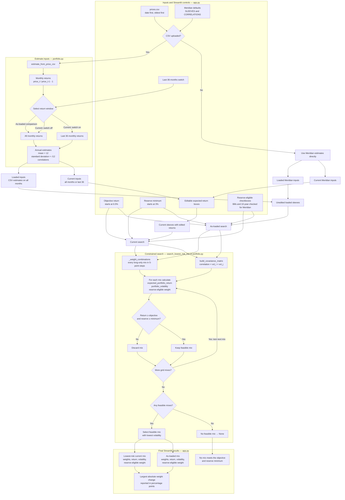

# Lab 15 – Portfolio Stability

## Application and Portfolio-Engine Flow

The app imports the Meridian inputs and calculation functions from `portfolio.py`; it does not maintain a second copy of the portfolio math.

## Meridian Correlation Validation

For this temporary validation run, the investment-grade bond–global equity correlation was changed from `0.25` to `0.50` symmetrically in both correlation-matrix cells. The 5-point search returned:

| Treasury bills | 10-year Treasury | Investment-grade bonds | Global equity | Expected return | Volatility | Reserve-eligible |
|---:|---:|---:|---:|---:|---:|---:|
| 0% | 40% | 0% | 60% | 6.52% | 9.73% | 40% |

The test used an in-memory copy of the correlation matrix. The original `0.25` correlations in `portfolio.py` were unchanged after the run.

## Historical Price Data

`prices.csv` contains five years of actual monthly adjusted closing prices. Daily adjusted closes were downloaded from Yahoo Finance, restricted to completed months from October 2021 through September 2026, and aligned by selecting the final trading date available for all four ETFs in each month. The file has 60 price observations, which produce 59 monthly returns; this is sufficient for both the full-sample and last-36-month estimator settings.

| Ticker | Data field | Source | Download date |
|---|---|---|---|
| BIL | Adjusted close | [Yahoo Finance historical data](https://finance.yahoo.com/quote/BIL/history/) | 2026-10-22 |
| IEF | Adjusted close | [Yahoo Finance historical data](https://finance.yahoo.com/quote/IEF/history/) | 2026-10-22 |
| LQD | Adjusted close | [Yahoo Finance historical data](https://finance.yahoo.com/quote/LQD/history/) | 2026-10-22 |
| VT | Adjusted close | [Yahoo Finance historical data](https://finance.yahoo.com/quote/VT/history/) | 2026-10-22 |

Validation checks confirmed that all 60 dates are strictly increasing, each row uses the same date for all four ETFs, every price is positive and numeric, and the values match the downloaded adjusted-close records to the six decimal places stored in `prices.csv`.

## Project 2 Mandate Translation

My Project 2 mandate targets **CPI + 4% annually after costs**. For this Lab 15 demonstration, I assume CPI is **2.5%**, which gives a numerical objective return of **6.5%**:

`2.5% CPI + 4.0% = 6.5% objective return`

The reserve minimum is **3%**. The portfolio must cover four quarterly distributions of $0.75 million from a $100 million portfolio:

`(4 × $0.75 million) ÷ $100 million = 3% reserve minimum`

For the selected ETF universe, **BIL and IEF are reserve-eligible**, while **LQD and VT are not reserve-eligible**. The historical return estimates calculated from adjusted closing prices are used as proxies for expected returns. They are not explicitly adjusted for every cost relevant to the mandate, so meeting the app's 6.5% estimated-return threshold does not by itself establish that the portfolio will earn 6.5% after all costs.

The app directly applies the objective return, reserve minimum, and long-only allocation rule. It does **not** directly enforce the mandate's **8% issuer limit**, **25% annual turnover limit**, or requirement that **90% of the portfolio be redeemable within five business days**. Those constraints require separate compliance checks before treating an allocation as mandate-compliant.

## My Portfolio Results

These are preliminary results using Meridian's default **6.5% objective return** and **3% reserve minimum**. They are not yet a final recommendation under my Project 2 mandate.

| Estimation window | BIL | IEF | LQD | VT | Expected return | Volatility | Reserve-eligible weight |
|---|---:|---:|---:|---:|---:|---:|---:|
| Full historical sample | 60% | 0% | 0% | 40% | 6.61% | 6.05% | 60% |
| Last 36 monthly returns | 85% | 0% | 0% | 15% | 6.75% | 1.79% | 85% |

The largest allocation change is **25 percentage points**: BIL increases from 60% to 85%, while VT decreases from 40% to 15%. This shows that the allocation is sensitive to the historical estimation window. The change in estimated inputs materially shifts the lowest-risk feasible mix, so these results should be evaluated under the constraints and decision criteria of my Project 2 mandate before making a final recommendation.

## Stress Test Results

Reducing VT's expected return by 1 percentage point caused its allocation to increase from 40% to 45%, while BIL decreased from 60% to 55%. This shows that the optimizer is sensitive to changes in expected returns, although the 5-percentage-point shift was smaller than the 25-point change observed when switching historical estimation windows.

## Your Call

**Decision: Pilot, not adopt.**

I would pilot this portfolio rather than immediately adopt it as my Project 2 starting allocation. Changing the historical estimation window resulted in a 25-percentage-point allocation shift, showing that the portfolio is sensitive to the return estimates used. Before adopting it, I would want to see more consistent results across different historical periods and confirm that the allocation satisfies my investment mandate.
